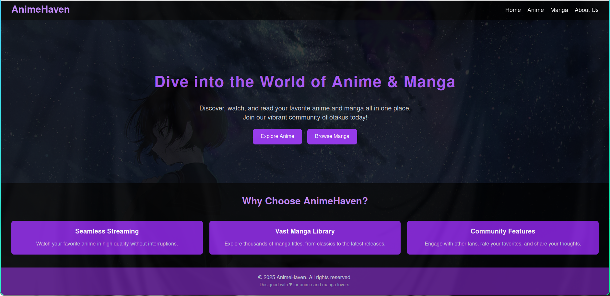
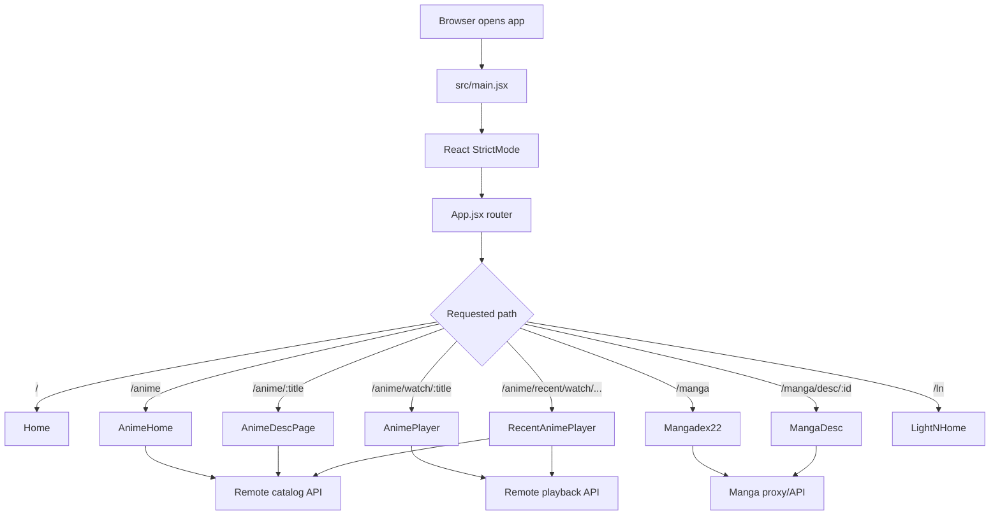

# 🌸 Anime Website

<p align="center">
  
</p>

<h1 align="center">Anime Website</h1>
<p align="center"><strong>A React and Vite exploration hub for anime, manga, and light novels.</strong></p>

<p align="center">
  
  
  
  
  
</p>

<p align="center">
  <a href="#-demo-gallery">Demo gallery</a> ·
  <a href="#-features-and-implementation-status">Features</a> ·
  <a href="#-run-locally">Run locally</a> ·
  <a href="docs/README.md">Documentation</a>
</p>

---

## ✨ Project overview

Anime Website is a client-side single-page application built with React 18, React Router, Vite, and Tailwind CSS. The codebase explores catalog discovery, anime metadata, episode grouping, browser-based playback through a third-party source, MangaDex-related catalog access, and an initial light-novel route.

The current implementation is a learning/prototype project, not a production streaming platform. Its user experience and data availability depend on third-party services and remote media hosts. Some routes are incomplete or experimental. This README reports the code as it exists rather than claiming planned capabilities are already delivered.

## 🎬 Demo gallery

The repository currently contains `anime.png`, which is project artwork. It is **not** represented as a screenshot of the running application.

| Asset | Purpose | Status |
|---|---|---|
| [Project artwork](anime.png) | Existing repository image and visual identity | Available |
| [Home route capture](docs/demo/home.png) | Browser screenshot of `/` | Capture pending |
| [Anime catalog capture](docs/demo/anime-catalog.png) | Browser screenshot of `/anime` | Capture pending |
| [Anime details capture](docs/demo/anime-details.png) | Browser screenshot of `/anime/:title` with a working provider response | Capture pending |
| [Manga catalog capture](docs/demo/manga-catalog.png) | Browser screenshot of `/manga` | Capture pending |
| [Playback capture](docs/demo/playback.png) | Browser screenshot with a legally usable test stream | Capture pending |

See [Demo asset guide](docs/demo/README.md) for capture instructions, required viewport sizes, naming conventions, and image quality checks. A placeholder or mockup must never be described as a real product screenshot.

## 🧭 Routes

| Route | Component | Intended responsibility | Implementation note |
|---|---|---|---|
| `/` | `Home` | Entry point linking to content areas | Current content is a minimal landing placeholder |
| `/anime` | `AnimeHome` | Search catalog and show recent episodes | Calls a configured third-party anime API |
| `/ln` | `LightNHome` | Light-novel area | Placeholder only |
| `/manga` | `Mangadex22` | Manga search/catalog experiment | MangaDex-style data request and incomplete UI |
| `/manga/desc/:manga_id` | `MangaDesc` | Manga metadata and cover experiment | Detail UI remains incomplete |
| `/anime/:title` | `AnimeDescPage` | Anime metadata and episode groups | External metadata request |
| `/anime/watch/:title` | `AnimePlayer` | Episode playback view | Selects a source from the remote response |
| `/anime/recent/watch/:id/:title` | `RecentAnimePlayer` | Recent episode playback and anime information | External metadata and playback requests |

The router is defined in `src/App.jsx`. Route behavior may be affected by host rewrites and third-party endpoint availability.

## ✅ Features and implementation status

| Area | Current state | Notes |
|---|---|---|
| React single-page app | Implemented | Mounted through `src/main.jsx` |
| Client-side routing | Implemented | React Router 6 browser router |
| Landing route | Basic | Simple links to manga, anime, and light novels |
| Anime search | Partial | Search form calls remote API; error/loading UX needs work |
| Recent episodes | Partial | Fetches recent episodes from configured service |
| Anime details | Partial | Fetches image, description, and episodes |
| Episode grouping | Implemented | Groups metadata into sets of ten |
| Video player | Partial | Uses ReactPlayer and a selected source from provider response |
| Manga catalog | Experimental | MangaDex-style calls and incomplete rendering |
| Manga details/covers | Experimental | Proxy and blob handling experiments |
| Light novels | Not implemented | Placeholder page |
| User accounts | Not implemented | No authentication or profile system |
| Watchlist/history | Not implemented | No persistence layer |
| Payments/subscriptions | Not implemented | No billing workflow |
| Backend/database | Not included | No owned API or database service in this repository |

## 🧱 Technology stack

| Technology | Role |
|---|---|
| React 18 | Component UI and state |
| Vite 5 | Local development server and production build |
| React Router DOM 6 | Browser-side routes |
| Tailwind CSS 3 | Utility-first styling |
| Axios | HTTP requests |
| Framer Motion | Animation dependency available to the project |
| React Player | Media player component |
| MangaDex Full API | Manga integration dependency |
| novel-cool | Novel/manga exploration dependency |
| ESLint 9 | Static code linting |
| PostCSS and Autoprefixer | CSS processing |

The dependency list is recorded in `package.json`. A dependency being installed does not mean every related feature is currently used or complete.

## 🗂️ Repository structure

```text
Anime_website/
├── .github/
│   ├── workflows/
│   │   └── update-readme.yml
│   └── PULL_REQUEST_TEMPLATE.md
├── docs/
│   ├── adr/
│   ├── demo/
│   ├── diagrams/
│   ├── accessibility.md
│   ├── api.md
│   ├── architecture.md
│   ├── data-flow.md
│   ├── deployment.md
│   ├── development.md
│   ├── features.md
│   ├── limitations.md
│   ├── project-structure.md
│   ├── qa.md
│   ├── security-review.md
│   └── ...
├── public/
├── src/
│   ├── components/
│   │   ├── manga_comps/
│   │   └── pageComponents/
│   ├── assets/
│   ├── App.jsx
│   ├── App.css
│   ├── index.css
│   └── main.jsx
├── anime.png
├── index.html
├── package.json
├── package-lock.json
├── vercel.json
└── vite.config.js
```

For a file-by-file explanation, see [Project structure](docs/project-structure.md).

## 🚀 Run locally

### Prerequisites

- Node.js 18 or later.
- npm (the repository includes `package-lock.json`).
- Network connectivity for remote catalog and media requests.

### Installation

```bash
git clone https://github.com/Brajesh31/Anime_website.git
cd Anime_website
npm ci
npm run dev
```

Open the local URL shown by Vite, normally `http://localhost:5173`.

### Quality checks

```bash
npm run lint
npm run build
npm run preview
```

- `lint` runs ESLint across the project.
- `build` creates the production bundle in `dist/`.
- `preview` serves the production build locally.

These commands do not test live third-party APIs or prove that every route works in a deployed environment. Follow the [QA plan](docs/qa.md) for manual route checks.

## 🔄 Application flow



## 🌐 External services and content rights

The browser currently calls third-party anime and manga services. Their uptime, response shape, CORS behavior, rate limits, media availability, and terms can change independently of this repository.

This project does not host or own external anime episodes, manga pages, artwork, or provider infrastructure. Use only sources and test media that you are authorized to access and display. Do not bypass paywalls, DRM, authentication, regional restrictions, or provider anti-abuse controls. See [API notes](docs/api.md), [limitations](docs/limitations.md), and [security review](docs/security-review.md).

## ♿ Accessibility and responsive review

The current source contains basic responsive Tailwind utility classes, but the project has not yet had a complete accessibility audit. Keyboard operation, visible focus, meaningful alternative text, contrast, player controls, loading/error announcements, and reduced-motion behavior should be checked before release.

Use the [accessibility checklist](docs/accessibility.md) and test at mobile, tablet, and desktop widths.

## 🧪 Testing and quality

Current automated scripts are limited to ESLint and the Vite production build. The repository does not yet have a component test suite, browser end-to-end tests, or provider contract tests. See [QA plan](docs/qa.md) for the concrete test matrix and [roadmap](ROADMAP.md) for planned engineering work.

## 🛠️ Troubleshooting

| Symptom | Likely cause | First check |
|---|---|---|
| Catalog is empty | Remote API unavailable, query not recognized, or response changed | Open browser Network tab and inspect the request |
| Images do not load | Provider host, CORS, or expired image URL | Inspect image request status and response headers |
| Player remains loading | Provider response has no expected source or the source is inaccessible | Inspect response shape; do not assume index `2` always exists |
| Direct route returns 404 on deployment | Host does not fall back to SPA entry point | Verify hosting rewrite configuration |
| Manga results do not render | Provider schema mismatch or unfinished component | Inspect `Mangadex22` response and rendering path |
| `npm ci` fails | Node/npm mismatch or lockfile issue | Use supported Node version and committed lockfile |

More detail: [Troubleshooting guide](docs/troubleshooting.md).

## 🤝 Contributing

Read [CONTRIBUTING.md](CONTRIBUTING.md) before opening a pull request. Include the affected route, third-party service assumptions, licensing/terms checks, screenshots where useful, and the exact commands you ran.

## 📚 Documentation index

Start at [docs/README.md](docs/README.md) for the full guide index, architecture references, operational notes, QA and governance documents.

## 🗺️ Roadmap

Planned engineering improvements include resilient API adapters, reliable loading/error states, typed provider contracts, route-level tests, improved accessibility, an actual light-novel experience, and better deployment verification. These are plans, not current features. Full list: [ROADMAP.md](ROADMAP.md).

## 📄 License

The repository's original project code is distributed under the MIT License in [LICENSE](LICENSE). Third-party packages, APIs, artwork, logos, and media have separate ownership and terms.

Last updated: 2026-11-16 06:31 UTC
