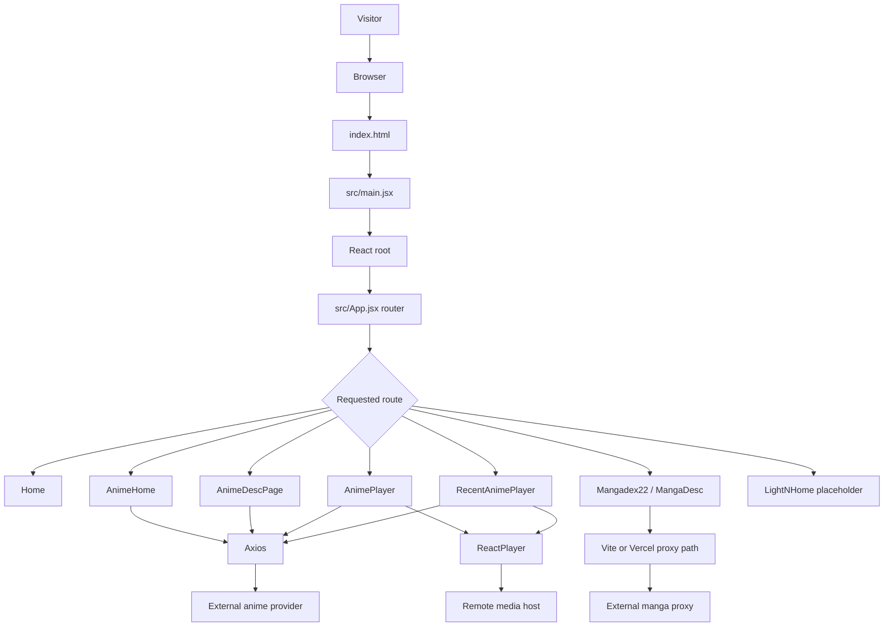

<p align="center"></p>
<h1 align="center">🌸 Anime Website</h1>
<p align="center"><strong>A React-based exploration of anime discovery, episode information, playback integration, and manga catalog experiments.</strong></p>
<p align="center">
<a href="https://react.dev/"></a>
<a href="https://vite.dev/"></a>
<a href="https://tailwindcss.com/"></a>
<a href="https://developer.mozilla.org/en-US/docs/Web/JavaScript"></a>
<a href="https://github.com/Brajesh31/Anime_website/actions/workflows/ci.yml"></a>
<a href="LICENSE"></a>
</p>
<p align="center"><a href="#overview">Overview</a> · <a href="#feature-matrix">Features</a> · <a href="#visual-gallery">Visuals</a> · <a href="#architecture">Architecture</a> · <a href="#getting-started">Getting started</a> · <a href="docs/README.md">Documentation</a></p>

---

## Overview

Anime Website is a browser-based single-page application built with React 18 and Vite. It brings together experiments around anime search, recent episode discovery, anime detail pages, episode navigation, remote playback metadata, and MangaDex-oriented search.

**Project maturity:** learning and integration prototype. It is not a complete streaming product or production-grade media service. Several screens are partial, some components are experiments, and important behavior depends on external APIs that this project does not operate.

This README separates implemented behavior from experiments and planned work. A dependency being installed does not prove a feature is complete.

## Contents

- [Overview](#overview)
- [Feature matrix](#feature-matrix)
- [Visual gallery](#visual-gallery)
- [Application routes](#application-routes)
- [Architecture](#architecture)
- [Technology stack](#technology-stack)
- [Repository layout](#repository-layout)
- [Getting started](#getting-started)
- [Configuration](#configuration)
- [Core user journeys](#core-user-journeys)
- [External services and data boundaries](#external-services-and-data-boundaries)
- [Quality checks](#quality-checks)
- [Accessibility](#accessibility)
- [Security and content rights](#security-and-content-rights)
- [Known limitations](#known-limitations)
- [Troubleshooting](#troubleshooting)
- [Contributing and governance](#contributing-and-governance)
- [Roadmap](#roadmap)
- [Documentation map](#documentation-map)
- [License](#license)

## Feature matrix

| Capability | Status | Current behavior | Important gap |
|---|---|---|---|
| React bootstrap | 🟢 Implemented | React root mounted from src/main.jsx | No application-wide state architecture |
| Browser routing | 🟢 Implemented | Routes declared in src/App.jsx | Player route declarations need validation |
| Landing page | 🟡 Basic | Home component is root route | Minimal landing experience |
| Anime search | 🟡 Partial | AnimeHome submits a query and stores provider results | Alert-based submit and limited error/loading UX |
| Recent episodes | 🟡 Partial | Recent feed requested on mount | Incomplete empty/error states |
| Anime details | 🟡 Partial | Metadata loaded and episodes grouped by ten | Assumes provider fields and arrays |
| Standard playback | 🟡 Partial | ReactPlayer receives a selected remote URL | Assumes sources[2] exists |
| Recent playback | 🟡 Partial | Requests episode and anime metadata | Fixed source index and limited recovery |
| Manga search | 🧪 Experimental | Mangadex22 calls a local proxy path | Incomplete rendering and cover workflow |
| Manga details | 🧪 Experimental | Detail component is routed | Not a complete chapter/reader experience |
| Light novels | ⚪ Placeholder | LightNHome route exists | No catalog or reader |
| Authentication | ❌ Not implemented | No account/session flow | No identity backend |
| Watchlist/history | ❌ Not implemented | No durable user state | No persistence |
| Backend/database | ❌ Not implemented | Browser-only app | No owned API or schema |
| Payments/subscriptions | ❌ Not implemented | No billing flow | Not in current scope |

## Visual gallery

### Existing project artwork

<p align="center"></p>

### Genuine browser screenshots

| Screen | Planned file | Status |
|---|---|---|
| Home | docs/demo/home.png | ⏳ Capture pending |
| Anime search and recent feed | docs/demo/anime-catalog.png | ⏳ Capture pending |
| Anime details and episode groups | docs/demo/anime-details.png | ⏳ Capture pending |
| Manga search experiment | docs/demo/manga-catalog.png | ⏳ Capture pending |
| Player with authorized test media | docs/demo/playback.png | ⏳ Capture pending |

The existing artwork is not a live UI capture. Screenshots will only be added after running the application in a browser and verifying the route. Do not present generated illustrations or architecture diagrams as product screenshots. See [demo capture policy](docs/demo/README.md).

### Technical diagrams

- [System architecture SVG](docs/diagrams/system-architecture.svg)
- [Anime user journey SVG](docs/diagrams/anime-user-flow.svg)
- [Playback flow SVG](docs/diagrams/playback-flow.svg)
- [Rendered Mermaid flowcharts and sequence diagrams](docs/diagrams/flows.md)

## Application routes

Paths below are transcribed from src/App.jsx. They are not a guarantee that each route works correctly in production.

| Declared path | Component | Responsibility | Status |
|---|---|---|---|
| / | Home | Landing page | Basic |
| /anime | AnimeHome | Search and recent feed | Partial |
| /ln | LightNHome | Light novel area | Placeholder |
| /manga | Mangadex22 | Manga search experiment | Experimental |
| /manga/desc/:manga_id | MangaDesc | Manga detail experiment | Experimental |
| /anime/:title | AnimeDescPage | Anime info and episode groups | Partial |
| anime/recent/watch/:id/:title | RecentAnimePlayer | Recent episode player | Partial, path convention needs review |
| anime/watch/:title | AnimePlayer | Episode player | Partial, path convention needs review |

**Important route observation:** the two player declarations do not begin with a leading slash, unlike the other top-level routes. Their matching behavior and the links that navigate to them should be tested together. See [route reference](docs/routes.md).

## Architecture

Anime Website is a browser-rendered React SPA. Route components own most request logic and local state. External services provide metadata and playback-source responses.



This is the current-state view. There is no project-owned application server or database between the browser and the anime provider.

## Technology stack

| Technology | Declared version family | Role |
|---|---|---|
| React / React DOM | 18.3 | UI and rendering |
| Vite | 5.4 | Development server and bundler |
| React Router DOM | 6.26 | Browser routing |
| Tailwind CSS | 3.4 | Utility styling |
| Axios | 1.7 | HTTP requests |
| ReactPlayer | 2.16 | Player UI |
| Framer Motion | 11.3 | Animation dependency |
| MangaDex Full API | 6.x | Manga integration dependency |
| novel-cool | 2.x | Novel/manga exploration dependency |
| ESLint | 9.x | Static analysis |
| PostCSS / Autoprefixer | 8.x / 10.x | CSS processing |

The lockfile is the resolved dependency record. See [dependency notes](docs/dependencies.md).

## Repository layout

```text
Anime_website/
├── .github/                 # Issue forms, PR template, workflows
├── docs/
│   ├── adr/                 # Architecture decision records
│   ├── demo/                # Screenshot capture guide
│   ├── diagrams/            # SVG and Mermaid diagrams
│   └── *.md                 # Product, engineering, QA and operations docs
├── public/                  # Static public assets
├── scripts/                 # Documentation validation
├── src/
│   ├── components/
│   │   ├── manga_comps/     # Manga experiments and pages
│   │   └── pageComponents/  # Anime detail and player pages
│   ├── assets/
│   ├── App.jsx              # Route declarations
│   └── main.jsx             # React entry point
├── anime.png                # Existing project artwork
├── index.html
├── package.json
├── package-lock.json
├── vercel.json              # Deployment rewrite rules
└── vite.config.js           # Vite and development proxy
```

See [audited project structure](docs/project-structure.md) and [asset inventory](docs/asset-inventory.md).

## Getting started

### Prerequisites

- Node.js 18 or later. CI currently validates with Node.js 20.
- npm compatible with the committed package lock.
- Git.
- Network access for external catalog and playback metadata requests.
- A modern browser for route and network inspection.

### Install

```bash
git clone https://github.com/Brajesh31/Anime_website.git
cd Anime_website
npm ci
```

Use npm ci to install from package-lock.json. Avoid deleting or regenerating the lockfile casually.

### Run locally

```bash
npm run dev
```

Vite prints the local URL, normally http://localhost:5173.

### Build and preview

```bash
npm run build
npm run preview
```

The production bundle is written to dist/. Previewing the bundle does not validate every production hosting rewrite or external provider.

### Available commands

| Command | Purpose |
|---|---|
| npm run dev | Start Vite |
| npm run lint | Run ESLint and report current source findings |
| npm run build | Create dist/ |
| npm run preview | Preview the production bundle |
| python scripts/check_docs.py | Validate local Markdown links |

See [installation](docs/installation.md) and [development](docs/development.md).

## Configuration

The repository has minimal runtime configuration. Provider URLs are currently embedded in source/configuration. The .env.example file is guidance only, it does not mean app variables are currently read.

Vite variables prefixed with VITE_ are exposed to browser code. Never place private API keys, tokens, passwords, database credentials, or privileged secrets in them. See [configuration reference](docs/configuration.md).

## Core user journeys

### Anime discovery
1. Open /anime.
2. Enter a search query.
3. Submit the form.
4. AnimeHome calls the external search endpoint.
5. If the response contains results, the component stores and renders them.
6. Select a result to open the detail route.

Current limitations: the submit handler displays an alert, request failures are logged, and loading/error states are incomplete.

### Anime details
1. The detail page reads its title route parameter.
2. It requests anime information.
3. It stores image, description, and episode data.
4. Episodes are grouped in sets of ten.
5. Selecting an episode navigates to the player route.

The component assumes that provider fields exist and have the expected shape.

### Playback
1. The player reads an episode identifier.
2. It requests playback metadata.
3. Current code selects response.data.sources[2].url.
4. The URL is passed to ReactPlayer.

The fixed index is fragile. The code does not implement a complete source-selection policy or unavailable state. Do not interpret it as a stable provider contract.

### Manga experiment
The manga route requests a local /aviv2/manga/info/ path. Vite forwards selected requests in development; Vercel has separate rewrite rules. The current rendering and cover workflow is incomplete.

## External services and data boundaries

The project does not own the anime provider, manga proxy, remote media hosts, metadata, or artwork. Availability, response schemas, CORS, rate limits, terms, and content access can change independently.

| Integration | Observed use | Ownership |
|---|---|---|
| Anime API host | Search, recent episodes, info, playback metadata | External |
| Manga proxy host | Search and cover/image experiments | External |
| Remote media URLs | Passed to ReactPlayer | External |
| npm packages | Build and runtime dependencies | Third party |

No provider service-level guarantee or content license is established by this repository.

## Quality checks

```bash
npm ci
npm run lint
npm run build
python scripts/check_docs.py
```

Current verification boundaries:
- ESLint has legacy findings in the existing source.
- The latest recorded CI run passed dependency installation, production build, and documentation-link validation.
- Lint is advisory in CI, so a green run does not mean lint is clean.
- No browser end-to-end suite or provider contract suite is present.
- A successful build does not prove live API or playback availability.

See [QA](docs/qa.md) and [testing strategy](docs/testing-strategy.md).

## Accessibility

Responsive utility classes exist, but a formal accessibility audit has not been completed. Review keyboard navigation, visible focus, form labels, image alternatives, contrast, reduced motion, player controls, and loading/error announcements. Test 320, 390, 768, 1366, and 1920 px widths. See [accessibility](docs/accessibility.md) and [test plan](docs/accessibility-test-plan.md).

## Security and content rights

- Treat provider JSON, image URLs, and media URLs as untrusted.
- Keep private credentials out of Vite client variables.
- Avoid logging tokens or unnecessary provider payloads.
- Review dependency advisories and lockfile changes.
- Do not bypass DRM, paywalls, authentication, regional restrictions, or provider rate limits.
- Only access or display content where rights and provider terms permit it.
- The repository MIT license does not grant rights to third-party anime, manga, logos, artwork, APIs, or media.

Read [SECURITY.md](SECURITY.md), [security review](docs/security-review.md), and [content rights](docs/content-rights.md).

## Known limitations

1. No owned backend, database, accounts, or durable user data.
2. Light-novel route is a placeholder.
3. Manga experience is experimental and incomplete.
4. Anime behavior depends on external response schemas.
5. Playback selects a source by fixed array index.
6. Loading, empty, retry, and error UX is incomplete.
7. Player route declarations and links need browser verification.
8. No component or browser E2E suite exists.
9. Accessibility audit is incomplete.
10. Real browser screenshots are pending.
11. Vite proxy rules do not automatically apply in production.
12. Third-party content rights are outside repository control.

See [risk register](docs/risk-register.md) and [limitations](docs/limitations.md).

## Troubleshooting

| Symptom | Likely cause | First investigation |
|---|---|---|
| Search has no results | Provider unavailable, query mismatch, changed schema | Inspect request URL, status and JSON |
| Recent feed is blank | Failed request or missing results | Inspect Network and Console |
| Detail page is empty | Invalid ID or missing provider fields | Check route parameter and payload |
| Player stays on Loading | Missing source or failed request | Inspect sources array and media request |
| Images fail | Remote host, CORS, expired URL | Inspect image request |
| Manga screen fails | Proxy mismatch or incomplete component | Compare request path and proxy rules |
| Nested route returns 404 | Host lacks SPA fallback | Review deployment rewrites |
| npm ci fails | Node/npm mismatch or lockfile issue | Use supported Node and committed lockfile |
| CI lint step reports errors | Existing source lint debt | Review ESLint output |

See [troubleshooting guide](docs/troubleshooting.md).

## Contributing and governance

Contributions should improve a real flow, reliability, accessibility, documentation, or maintainability. Read [CONTRIBUTING.md](CONTRIBUTING.md), inspect whether a component is active in the router, reproduce the behavior, check provider terms, run validation, and include test evidence.

Project policies: [Code of Conduct](CODE_OF_CONDUCT.md) · [Security](SECURITY.md) · [Support](SUPPORT.md) · [Code owners](CODEOWNERS) · [Changelog](CHANGELOG.md) · [Roadmap](ROADMAP.md).

## Roadmap

Priority work:
- Stabilize routes and add direct-navigation tests.
- Replace fixed-index playback selection with validated source selection.
- Add explicit loading, empty, error, retry, and unavailable states.
- Centralize provider calls and normalize response payloads.
- Add component and browser tests.
- Complete accessibility and security reviews.
- Improve manga flow or isolate it as an experiment.
- Decide whether a light-novel feature is in scope.
- Capture genuine screenshots after running the app in a browser.

See [ROADMAP.md](ROADMAP.md). Planned items are not current features.

## Documentation map

| Topic | Document |
|---|---|
| Documentation hub | [docs/README.md](docs/README.md) |
| Product scope | [Product brief](docs/product-brief.md) |
| Feature status | [Feature inventory](docs/features.md) |
| Routes and parameters | [Route reference](docs/routes.md) |
| Architecture | [Architecture](docs/architecture.md) |
| Data journeys | [Data flow](docs/data-flow.md) |
| External API assumptions | [API reference](docs/api.md) |
| Configuration | [Configuration](docs/configuration.md) |
| Dependencies | [Dependencies](docs/dependencies.md) |
| Testing | [Testing strategy](docs/testing-strategy.md) |
| Security | [Security review](docs/security-review.md) |
| Rights and provider terms | [Content rights](docs/content-rights.md) |
| Deployment | [Deployment](docs/deployment.md) |
| Operations | [Operations](docs/operations.md) |
| Risk tracking | [Risk register](docs/risk-register.md) |
| Diagrams | [Diagram catalogue](docs/diagrams/README.md) |
| Assets and screenshots | [Asset inventory](docs/asset-inventory.md) |

## License

Project source code is distributed under the MIT License. See [LICENSE](LICENSE). Third-party packages, services, artwork, logos, metadata, and media remain subject to their respective owners' terms.

<p align="center"><sub>Documentation describes the checked-in implementation and records known gaps. Last reviewed: 2026-11-16.</sub></p>
