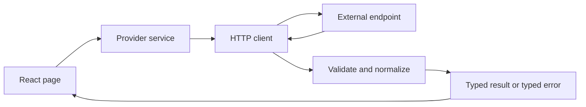

# 🌐 API and integration notes

## Current integration inventory

The API calls are embedded in page components rather than isolated in one service module.

| Domain | Example path in source | Used by | Status |
|---|---|---|---|
| Anime search | `/anime/gogoanime/{query}` | `AnimeHome`, `AnimeBtn` | Remote dependency |
| Recent episodes | `/anime/gogoanime/recent-episodes` | `AnimeHome` | Remote dependency |
| Anime information | `/anime/gogoanime/info/{id}` | `AnimeDescPage`, `RecentAnimePlayer` | Remote dependency |
| Episode playback | `/anime/gogoanime/watch/{episodeId}` | Player components | Remote dependency |
| Manga search/info | `/aviv2/manga/info/{query}` | Manga components | Proxy experiment |
| Manga cover | `/aviv2/manga/cover/{id}` | `MangaDesc` | Proxy experiment |
| Manga page image | `/avi2/manga/image/{id}/{file}` | Manga components | Proxy experiment |

The anime base URL currently appears as `https://animeapi-xi.vercel.app`. The manga proxy target appears in Vite and Vercel configuration. Provider names, ownership, service-level guarantees, and licensing terms are not established by this repository.

## Response assumptions visible in code

- Search and recent-episode responses are expected to have a `results` array.
- Anime info is expected to include `image`, `description`, and `episodes`.
- Episode objects are expected to include `id`, `number`, and `title`.
- Playback responses are expected to include a `sources` array with a playable URL. Existing code selects an item by fixed index, which is fragile.
- Manga responses are expected to expose a `data` array with nested attributes in some paths.

These are observed assumptions, not guarantees from a provider contract.

## Recommended API adapter design

Future implementation should move network access into `src/services/` and make the page components consume normalized results.

Recommended adapter responsibilities:

1. Keep base URLs and route construction in one place.
2. Encode query and path parameters.
3. Apply a reasonable timeout.
4. Pass AbortSignal to requests where possible.
5. Validate provider response shape before accessing nested fields.
6. Normalize errors into network, provider, schema, and unavailable categories.
7. Avoid logging full provider responses or private request headers.
8. Respect service terms, rate limits, and caching rules.

## Configuration and secrets

No private API key is currently required by the documented local setup. Do not add secrets to `VITE_*` variables because Vite exposes those values to browser code. Any future secret-bearing integration must be mediated by a server-side service.
