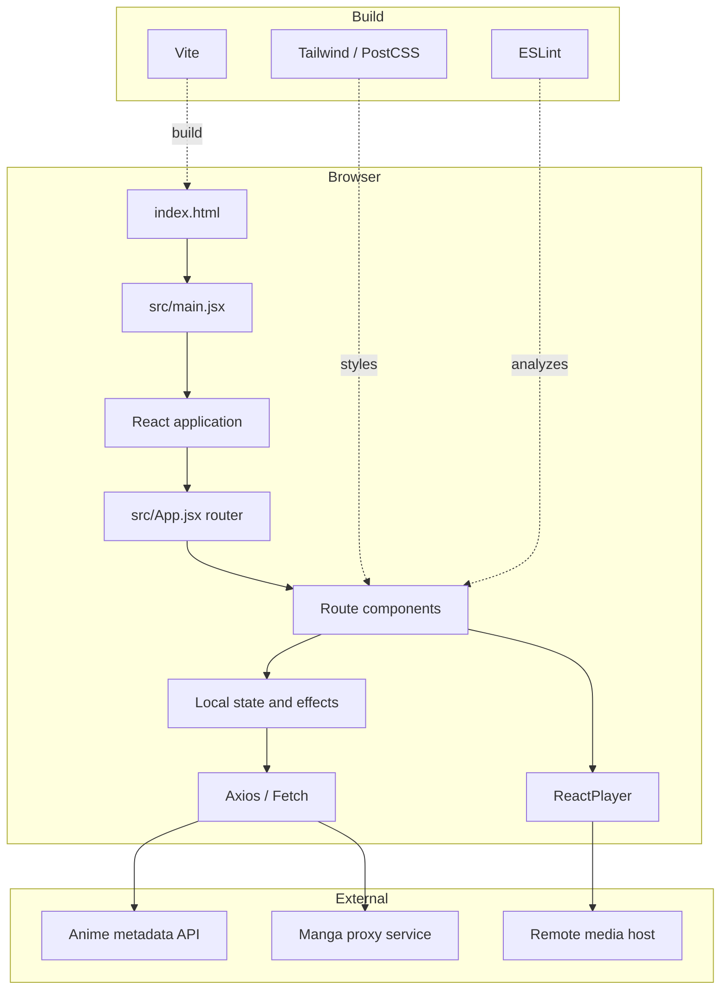

# 🏗️ Application architecture

## 1. Architectural summary
Anime Website is a client-rendered React single-page application. Vite provides local development and production bundling. React Router selects a page component from the browser URL. Most pages own their own state and HTTP requests. The browser communicates with external anime and manga services.

There is no project-owned API server, database, queue, cache, or identity service in the current repository. Describe this as a frontend prototype with external integrations, not a full-stack streaming platform.

## 2. Runtime component diagram

## 3. Bootstrap and render lifecycle
1. Browser requests index.html.
2. The module entry loads src/main.jsx.
3. The entry imports global CSS and mounts React.
4. src/App.jsx creates the browser router and route table.
5. React Router renders the component for the matched path.
6. The page renders its initial local state.
7. Effects or user actions start Axios requests.
8. The page stores selected response fields in local state.
9. React re-renders the affected subtree.
10. Playback routes pass a selected remote URL to ReactPlayer.

## 4. Responsibility map

| Layer | Source | Responsibility | Current limitation |
|---|---|---|---|
| Document shell | index.html | HTML metadata and root element | Minimal shell |
| Entry | src/main.jsx | React mount and global CSS | No shared state provider |
| Route composition | src/App.jsx | Route declarations | Player paths need validation |
| Anime discovery | AnimeHome.jsx | Search and recent feed | Incomplete request states |
| Anime details | AnimeDescPage.jsx | Metadata and episode groups | Assumes provider schema |
| Standard player | AnimePlayer.jsx | Episode request and player UI | Fixed source index |
| Recent player | RecentAnimePlayer.jsx | Anime metadata and playback | Fixed source index and limited recovery |
| Manga experiment | manga_comps/* | Search/detail experiments | Incomplete |
| Styling | CSS and Tailwind | Layout and visual styles | No documented design token system |
| Local proxy | vite.config.js | Selected development forwarding | Not a production backend |
| Hosting rules | vercel.json | Deployment rewrites | Must be tested independently |

## 5. State ownership
Inspected components use local React hooks such as useState and useEffect. There is no shared store, server cache, or persistence layer. Search results and selected URLs exist for the component lifetime and are normally lost on reload.

## 6. Integration boundaries
- **Anime provider:** frontend requests search, recent episodes, metadata, and playback source metadata. Provider uptime, schema, CORS, and limits are runtime dependencies.
- **Manga proxy:** the page calls local paths. Vite and Vercel have separate routing configuration and may behave differently.
- **Media host:** the player receives a URL from a provider response. The project does not store or serve the video.

## 7. Failure boundaries
- Build failure: Vite or dependency configuration.
- Route failure: route declaration, URL generation, or static-host fallback.
- Catalog failure: provider availability, HTTP response, CORS, or schema.
- Image failure: missing/expired URL or remote host policy.
- Playback failure: missing source, unsupported format, media host denial, or browser capability.
- Manga failure: proxy configuration, remote proxy availability, or component defects.

## 8. Architectural debt
1. Request construction is duplicated in page components.
2. Response payloads are consumed without a shared validation layer.
3. Fixed-index playback selection is fragile.
4. Error and loading states are inconsistent.
5. Provider base URLs are embedded in source/configuration.
6. Automated route and provider contract tests are absent.
7. Active and experimental components coexist.
8. There is no durable data model.

## 9. Recommended evolution
1. Stabilize route declarations and path builders.
2. Add provider service modules.
3. Normalize provider payloads into explicit frontend models.
4. Add cancellation, timeouts, and user-visible states.
5. Add component and browser tests.
6. Add a server only if a concrete requirement exists, such as private credentials.
7. Define privacy, retention, and authorization before adding accounts or persistence.

These are recommendations, not existing layers.
