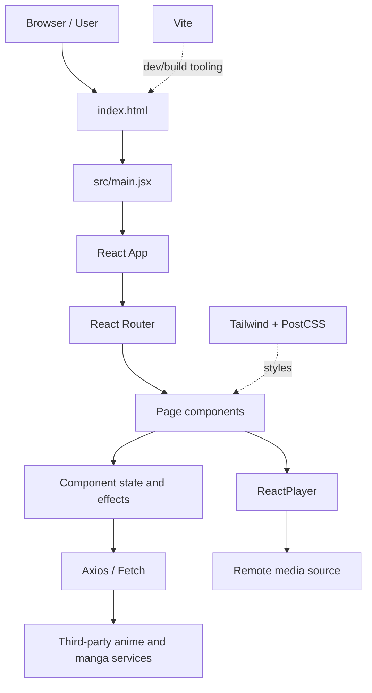

# 🏗️ Architecture

## Overview

The application is a browser-rendered React single-page application. Vite supplies the development server and production bundler. React Router maps URL paths to page components. Individual page components call remote services through Axios or browser fetch.

## Bootstrap sequence

1. The browser requests `index.html`.
2. The module script loads `src/main.jsx`.
3. `createRoot` mounts the application under React StrictMode.
4. `App.jsx` constructs a browser router.
5. The route table selects a page component.
6. A page renders its initial state and may start requests from effects or user actions.
7. State updates cause React to render returned data.

## Responsibilities

| Layer | Files | Responsibility |
|---|---|---|
| HTML shell | `index.html` | Document metadata and root mount point |
| Entry | `src/main.jsx` | React mount and global CSS |
| Router | `src/App.jsx` | Route definitions and page composition |
| Screens | `src/components/**` | Route-specific interface and local state |
| Styling | `src/index.css`, `src/App.css`, Tailwind classes | Visual presentation |
| Local proxy | `vite.config.js` | Development-only proxy behavior |
| Deployment rewrites | `vercel.json` | Hosting rewrite rules |
| Remote providers | URLs in page components | Data and media outside repository control |

## State and data

State is local to components through React hooks. There is no shared application store or persistent user database in the current source. Search results, selected metadata, and media source URLs are held in component state for the current page lifetime.

## Architectural constraints

- The browser calls provider endpoints directly in several components.
- Endpoint URLs are hard-coded in source files.
- Response structures are assumed in places, including selection of a playback source by array index.
- Error handling is inconsistent across components.
- Development proxy rules do not automatically become production proxy behavior.
- Some components contain experimental or incomplete code paths.

## Future direction

Centralize provider calls in a service layer, validate response schemas, use abortable requests, add route-level error boundaries, and introduce mocked tests. Keep any server-side credential private and outside Vite-exposed variables.
