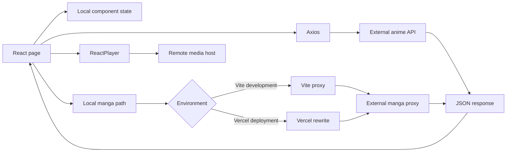

# 🔄 Data flow and request lifecycle

## 1. Current request topology

The browser is the application runtime. React pages initiate HTTP requests and keep response data in local state. Anime requests go directly to the configured external host. Manga requests use local paths forwarded through Vite or deployment configuration.

## 2. Search flow
AnimeHome stores search text in inputValue. Form submission prevents the default browser action, displays an alert, then calls the search helper. The helper issues an Axios GET and checks whether data.results exists. If present, results are stored in titles; otherwise an empty array is stored.

Request errors are logged. The screen does not expose a complete request-state model, so a failed request can appear similar to a no-results response.

## 3. Recent episode flow
On mount, an effect requests the recent-episode endpoint. The response is logged and, if data.results exists, stored in recentTitle. A missing results property resets the list. A rejection is logged. The selected item supplies an anime ID and episode ID to a recent-player URL.

## 4. Anime detail flow
AnimeDescPage reads the route parameter named title, appends it to the anime info endpoint, then stores image, description, and episode array in separate state values. Episodes are split into groups of ten and rendered in collapsible details elements. The component assumes expected fields exist.

## 5. Playback flow
The player reads a route parameter, requests playback metadata, and selects sources[2].url. If present, the URL is stored and passed to ReactPlayer. If the request fails, the error is logged. If the expected source is missing, the current UI does not provide a complete fallback.

## 6. Manga flow
The manga page submits a query to /aviv2/manga/info/. In local development, Vite forwards selected paths. Vercel has separate rewrites. The component expects a data collection and nested English title field. Current manga rendering is experimental.

## 7. Data lifetime and privacy
Response data is held in component state. The repository does not persist searches, watch history, or personal preferences to a project-owned database. Avoid exposing secrets or logging unnecessary provider data even without persistence.

## 8. Recommended request-state contract
Each network-backed screen should distinguish idle, loading, success, empty, error, and unavailable. This is a recommendation and is not consistently implemented today.
