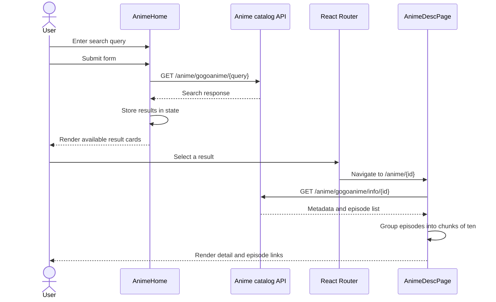
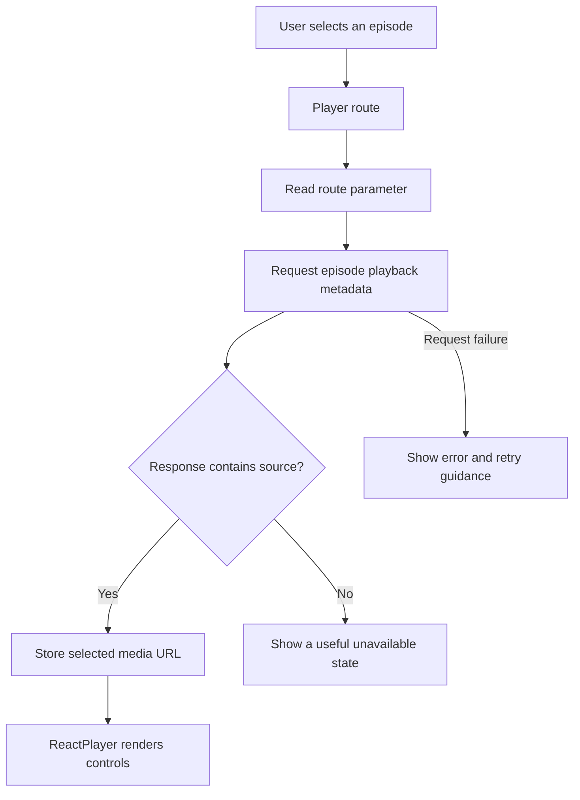

# 🔀 Data flow

## Anime search flow

## Recent episode flow

1. `AnimeHome` mounts.
2. Its effect requests the recent-episodes endpoint.
3. A response containing `results` is stored in `recentTitle`.
4. The component maps items into links.
5. The recent player uses route parameters to request metadata and playback data.

This flow assumes that the provider continues to return the expected `results`, `id`, `episodeId`, image, and title fields.

## Playback flow

The final two states are recommended behavior; the current implementation mainly logs request errors and may remain on a loading message. Do not assume robust fallback exists yet.

## Manga flow

The manga screen submits a query to a local path beginning with `/aviv2/manga/info/`. Vite development configuration proxies selected paths to an external service. The Vercel configuration includes corresponding rewrite experiments. The response is stored as a list, but the current component contains incomplete and inconsistent rendering logic.

## Trust boundary

All provider data is untrusted input. Validate arrays, object properties, IDs, strings, image URLs, and media URLs before rendering or passing them to a player. Never treat a provider response as proof that the media is licensed for redistribution.
