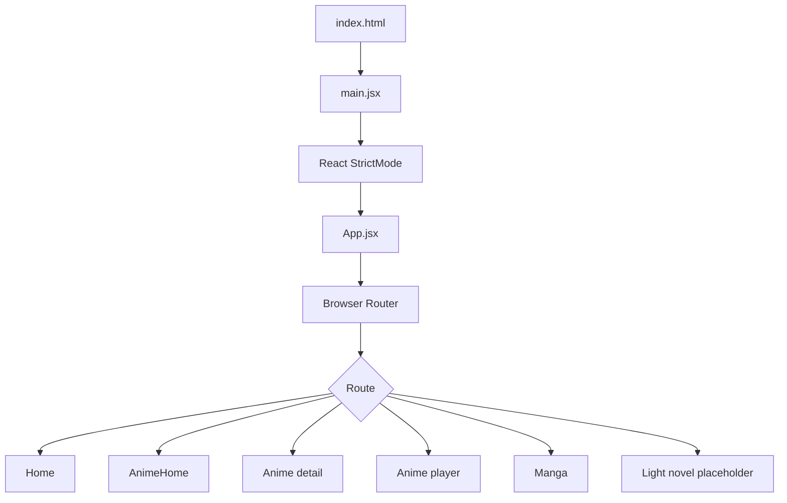
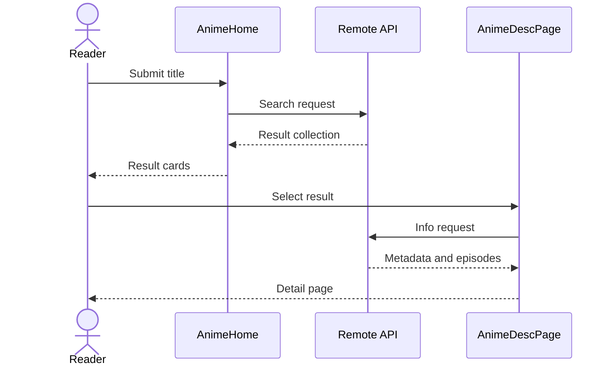
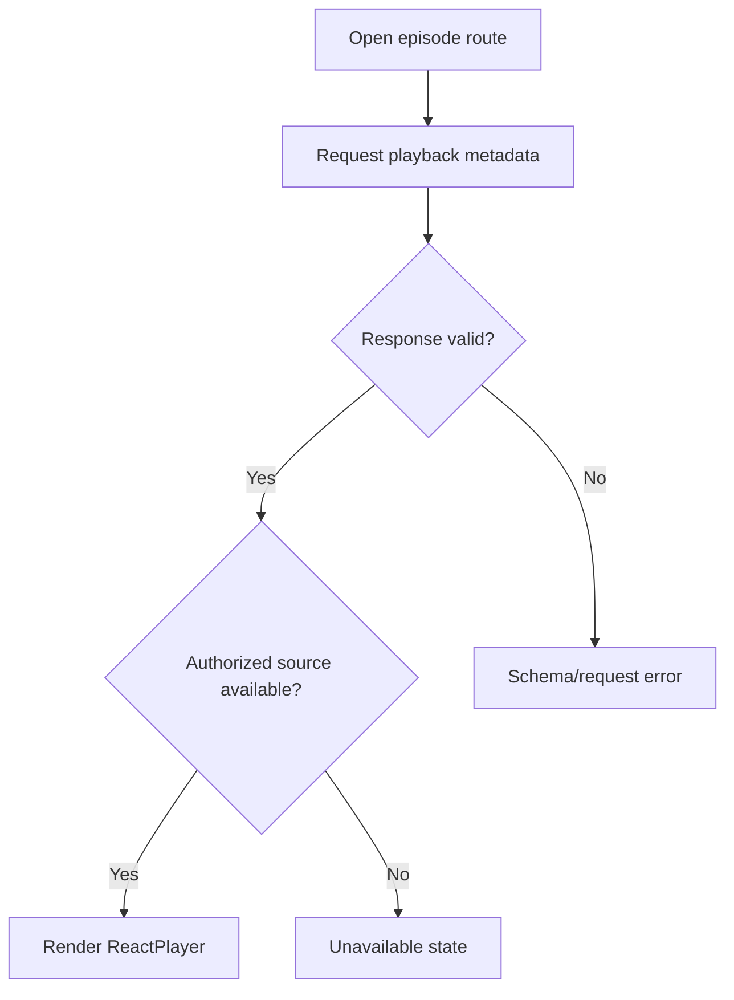

# 🧩 Architecture diagrams

The diagrams below are maintained as Mermaid source in Markdown, so they remain reviewable and editable.

## 1. Application bootstrap and route selection

## 2. Search-to-detail sequence

## 3. Playback source selection

The validated and authorized checks are recommended target behavior. Existing player code should be hardened before those checks are treated as implemented.

## Rendered SVG assets

These diagrams are also committed as standalone SVG image files for reuse in documentation and presentations:

- [System architecture diagram](system-architecture.svg)
- [Anime discovery user flow](anime-user-flow.svg)
- [Playback request flow](playback-flow.svg)

The SVGs are technical diagrams, not screenshots of the running application.
