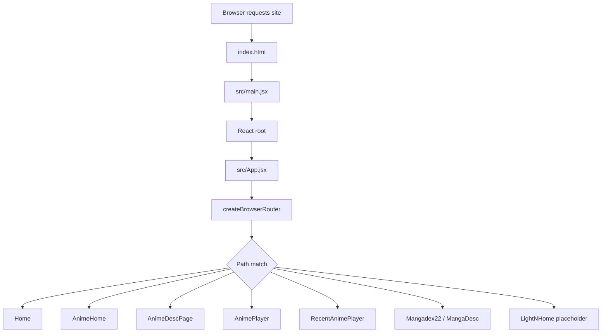
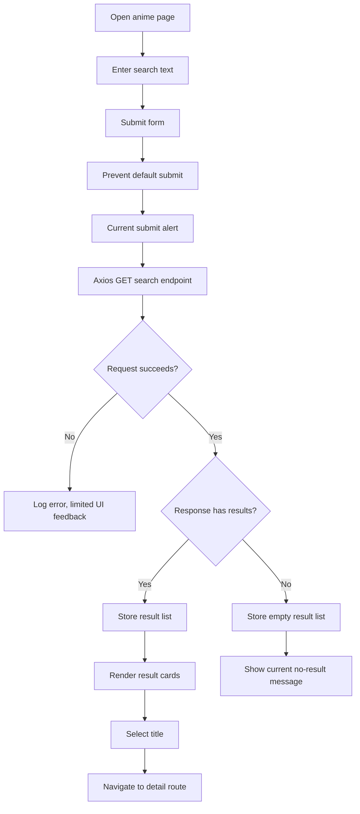
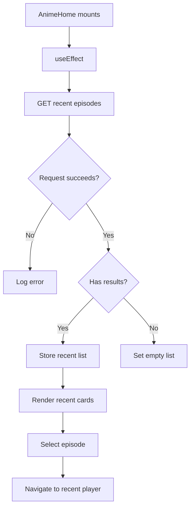
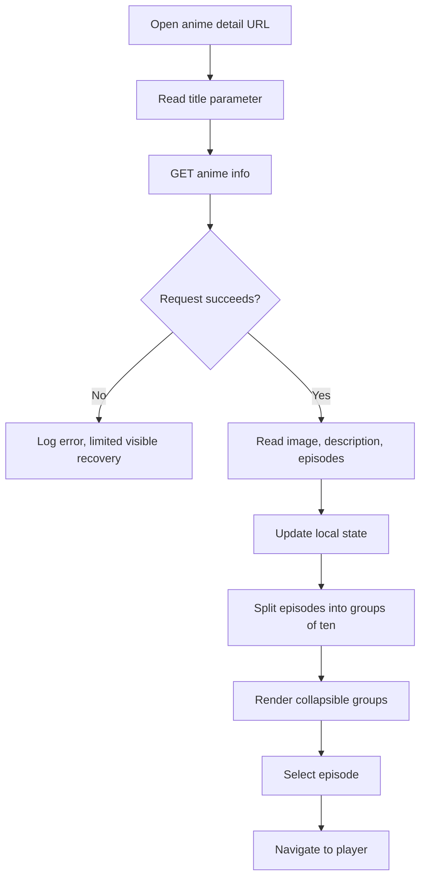
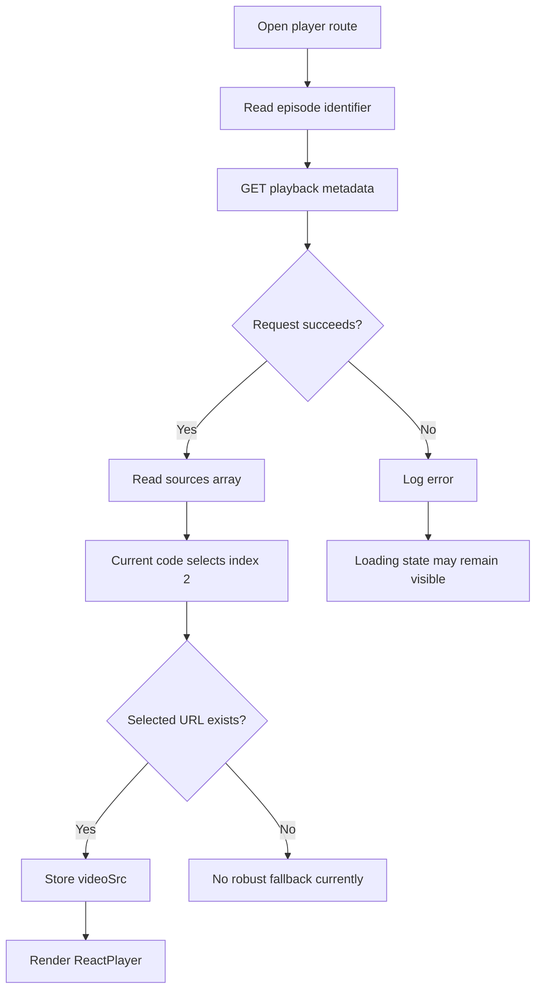
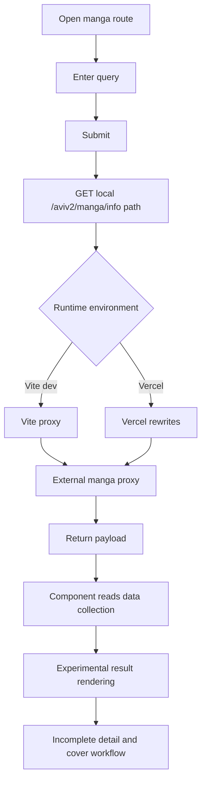
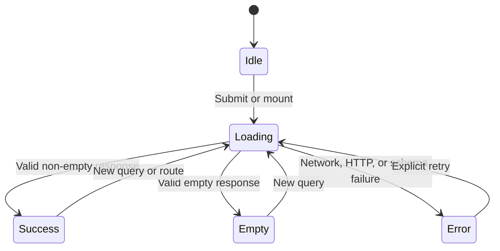
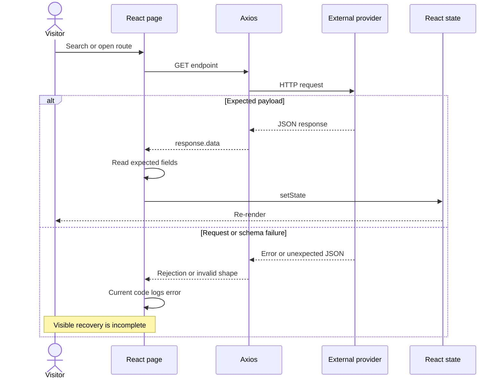
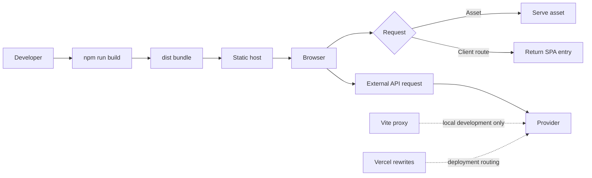
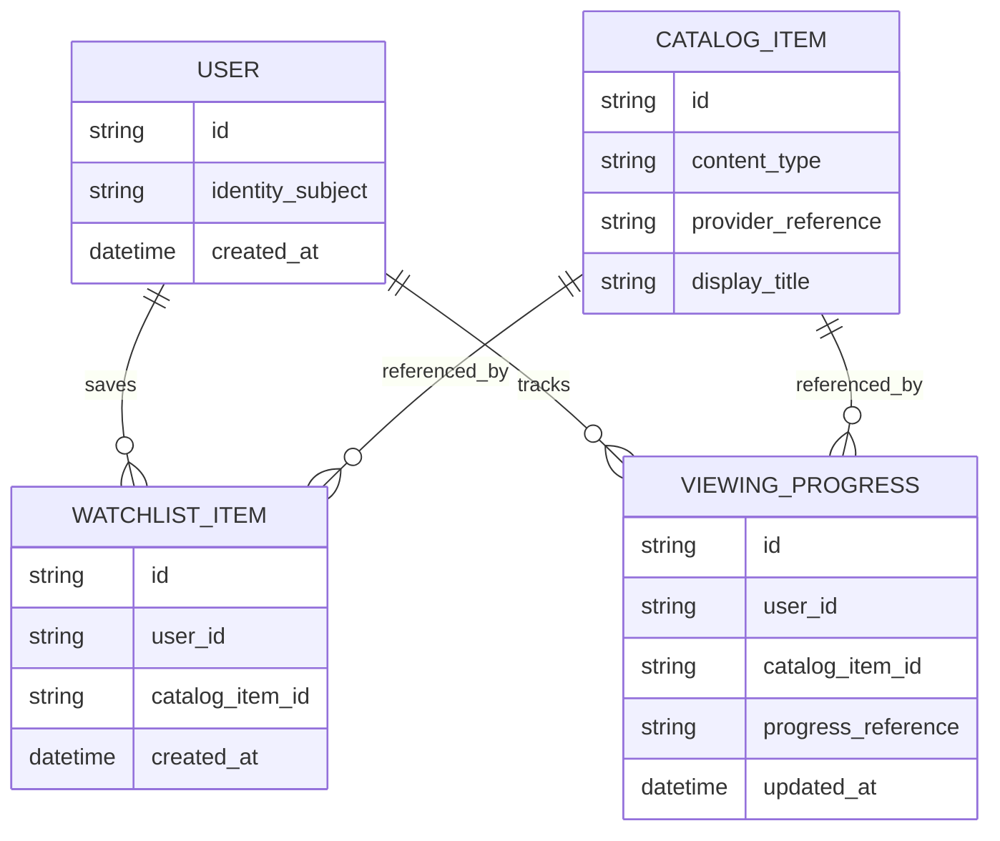

# 🔀 Mermaid flowcharts, sequences, and state models

This is the editable source for GitHub-rendered diagrams. Current behavior and proposed future behavior are labeled separately.

## 1. Application boot and route selection

## 2. Anime search journey

## 3. Recent episode discovery

## 4. Anime detail and episode grouping

## 5. Playback request

## 6. Manga search experiment

## 7. Recommended request lifecycle, target state model

This explicit state model is recommended future behavior. The current UI does not consistently implement every state.

## 8. Provider request sequence

## 9. Deployment path

## 10. Conceptual future persistence model

**This ER diagram is a future design sketch only.** The current repository has no database, users, watchlist, or viewing-progress persistence. Do not create migrations from it without a reviewed product and security decision.
