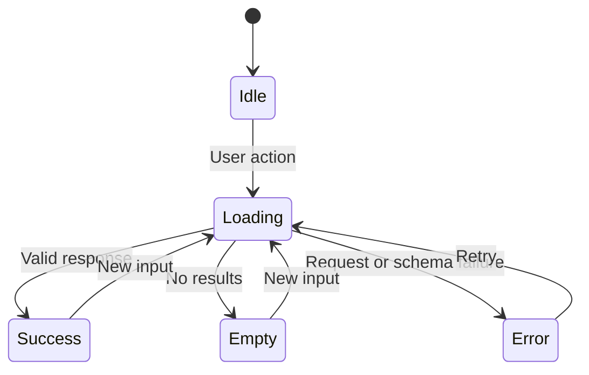
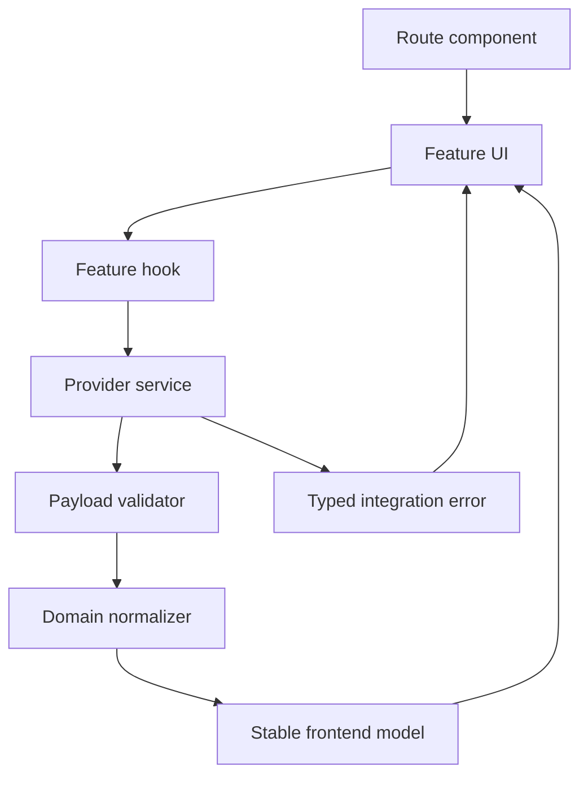

# 🧠 System design and evolution plan

## Current design
The current system is a frontend-only React SPA. Vite builds the browser bundle, React Router selects pages, page components own local state and HTTP requests, Axios communicates with remote metadata endpoints, and ReactPlayer receives a remote media URL. There is no project-owned server, database, identity provider, or media storage.

## Current vs target responsibilities

| Concern | Current | Recommended target |
|---|---|---|
| Routing | Route table in App.jsx | Central route builders and route tests |
| HTTP calls | Duplicated in pages | Provider service modules |
| Payload handling | Direct property reads | Runtime validation and normalization |
| Request state | Arrays/booleans and console errors | Explicit state model |
| Playback source | Fixed index 2 | Validated selection by supported format/quality |
| Error handling | Mostly console logging | User-visible typed error states |
| Persistence | None | Add only after product/privacy requirements |
| Testing | Lint/build/docs check | Unit, component, route, accessibility, contract tests |
| Observability | Browser console/network panel | Sanitized reporting if justified |

## Target request lifecycle

## Proposed frontend layering

This is a target architecture, not the current module layout.

## Proposed service contract
A service function should accept explicit parameters and return a normalized success or typed failure. It should not expose raw provider response objects to every screen. It should not assume that provider array ordering is stable.

## Security considerations
- Keep privileged secrets out of browser code.
- Treat provider responses and media URLs as untrusted.
- Validate protocol and expected host before playback.
- Respect provider terms and rate limits.
- Avoid collecting personal data without a purpose and retention policy.
- Add authorization before introducing user-owned persistence.

## Evolution sequence
1. Verify and stabilize route declarations and path builders.
2. Extract provider URLs and requests into service modules.
3. Add response validators and normalized models.
4. Implement loading, empty, error, retry, and unavailable states.
5. Add unit and component tests.
6. Add browser route tests.
7. Complete accessibility and security reviews.
8. Consider persistence only after a documented product requirement.

## Architecture decision records
New decisions should record context, decision, alternatives, consequences, and status: proposed, accepted, superseded, or deprecated.
