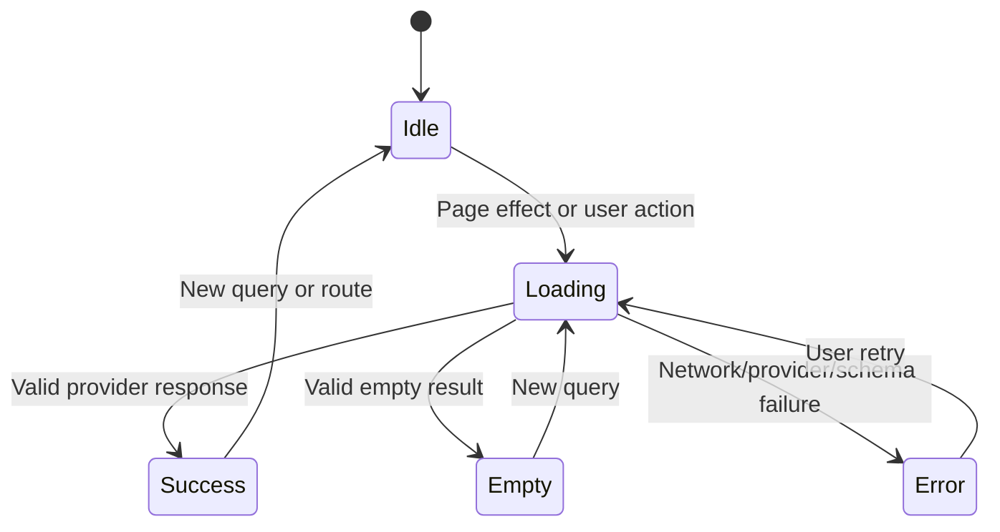

# 🧠 System design

## Current design
The client uses page-level React state and HTTP calls embedded in route components. `App.jsx` declares routes. Vite development proxy rules and Vercel rewrites are separate configurations.

## Target request lifecycle

## Recommended responsibilities
- Route components: read parameters and compose the screen.
- Feature components: render search, cards, episodes, and player controls.
- Provider services: construct requests and enforce timeouts.
- Validators: check provider payload shape.
- Domain adapters: normalize remote data into stable app models.
- UI state: represent idle, loading, success, empty, and error explicitly.

This is a future design direction, not the current module organization.
