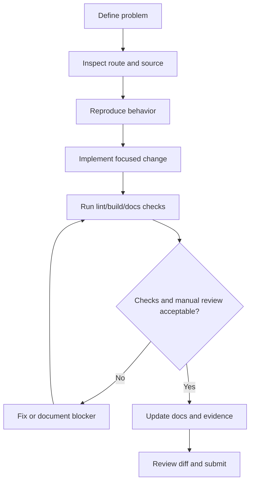

# 🔁 Contributor and maintenance workflow

## Purpose
This document describes the recommended workflow for changes to the current React/Vite prototype. It is a process guide, not an automated deployment specification.

## 1. Select a bounded change
Describe the user or maintainer problem, affected route, expected result, and non-goals. Avoid combining unrelated refactors with a documentation or feature fix.

## 2. Inspect current implementation
- Read src/App.jsx to identify active route elements.
- Read the target component and its imports.
- Inspect provider URLs and proxy/deployment configuration.
- Check whether similarly named components are experiments.
- Review current limitations and risk register.

## 3. Reproduce
Start the app with npm run dev. Record the route, browser, viewport, network request, response status, and actual UI behavior. Separate local app failures from provider outages.

## 4. Implement and validate
Keep changes focused. Validate provider data and URLs. Add explicit request states where relevant. Do not add secrets or unauthorized content. Run npm ci, lint, build, and documentation validation.

## 5. Update evidence
Update feature status, route/API docs, diagrams, risk register, and README as required. Capture screenshots only from a real running route. Label mockups and technical diagrams correctly.

## 6. Review and submit
A change description should include intent, scope, routes affected, provider assumptions, tests run, known limitations, and screenshots where useful. Review generated diff for accidental deletion or lockfile churn.

## Workflow diagram

## Change categories
- **Documentation-only:** no application source changes; verify links, Mermaid, and factual accuracy.
- **UI behavior:** add component and route verification; include genuine screenshots when possible.
- **Provider integration:** review terms, payload schema, error states, and proxy behavior.
- **Configuration/deployment:** test development and deployed behavior separately.
- **Security-sensitive:** follow SECURITY.md and avoid public disclosure of exploitable details.

## Completion standard
A task is complete only when the requested change is present, existing unrelated files remain intact, relevant checks are run, and known failures are reported honestly.
