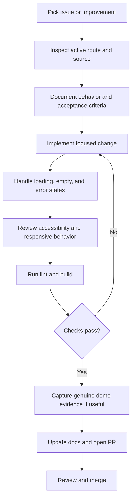

# 🔄 Contributor workflow

## Feature workflow

## Pull request evidence

A useful change description identifies affected routes, provider dependencies, user-visible behavior, rights/terms checks, responsive impact, and validation commands. Attach a screenshot only when it is an actual capture of the changed UI.

## Safe changes

Do not replace working features with decorative mockups. Keep old experimental components until their purpose and usage are checked. Remove obsolete source only through a separately reviewed cleanup change.
